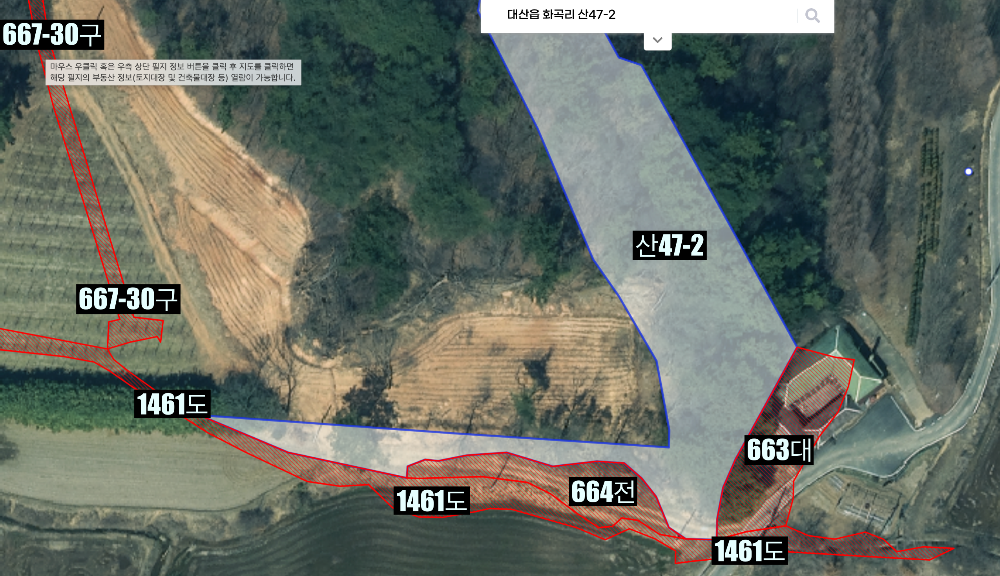
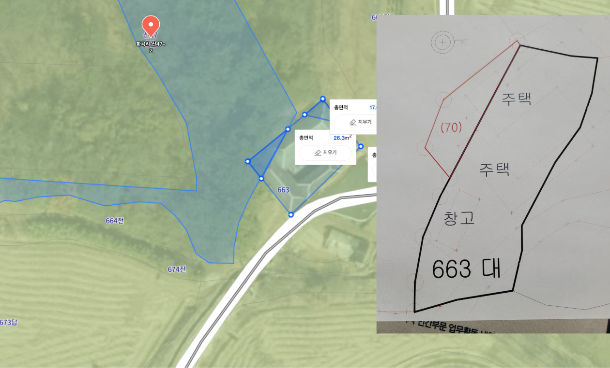

## # 화곡리 664전 김인집 할아버지_소유권 - 김상수 도둑질

### # 지도상 필지 정보
- 664전 : 화곡리 664 : 김인집 할아버지 소유지
- 산47-2 (흰색 필지) : 화곡리 산47-2 : 김지훈
- 663대 (집): 화곡리 663 : 김상수
- 1461도 : 하단 가로 축으로 지나는 도로 664전과 인접함
- 667-30구 : 지도 표기상 과수원을 걸쳐있으나, 실제로는 과수원옆으로 자연 발생한 자연 배수로

### # 김인집 할아버지 소유지 ( 화곡리 664 )
- 주소 : 충청남도 서산시 대산읍 화곡리 664
- 면적 : 251m² ( 76평 )
- 토지대장 소유자 : 김인집 (1912년05월24일)
- 등기부 존재 안함
    - 화곡리 663번지 김상수가 세금내고 있음 (10년 이상? : 세정과 확인필요)
    - 농지보상금을 노리며, 664번지 토지를 가로채려는 의도

- 아버지(김상경)와 통화시 본인 토지 맞다고 우김
    - 건들지 말라며 호통치며 겁박함

- 주변으로 도로(1461도를 지나는 3m 도로)를 내려면 
  - "사용승락"을 김상수에게 받아야하는 어처구니 없는 상황 (시청에 확인함)
  - 664번지를 인접해 지나는 1461도의 도로 폭이 0.5m로 2.5m 가량 "사용승락" 필요

### # 664번지 토지대장
대장%20등본%20발급(열람).jpeg)

### # 도둑놈 정보
  - 이름 : 김상수
  - 주소 : 충청남도 서산시 대산읍 화곡리 663

#### # 기타 참고사항
  - 663대(김상수) 건축물 일부(10평)가 산47-2(김지훈)를 침범함 
  - 아버지(김상경)과 통화시 그 뒤에 산은 다 자기 땅이라며 호통침

